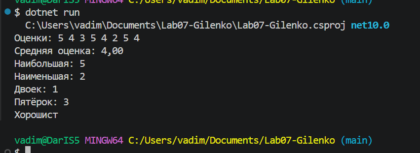
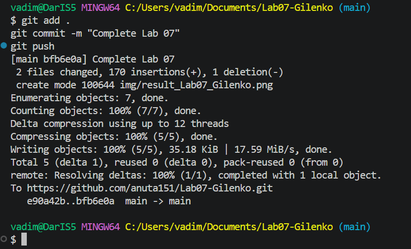

# Практическая работа №7

**ФИО:** Гиленко Анна  
**Группа:** ИСП-241 

## Что изучено

- **Массивы** — это набор однотипных значений под одним именем. Индексация начинается **с нуля**, поэтому последний элемент всегда имеет индекс `Length - 1`. Обращение к несуществующему индексу приводит к ошибке `IndexOutOfRangeException`.
- **`foreach` vs `for`** — `foreach` удобен, когда нужны только значения элементов (без индекса). Но через `foreach` элементы **только читаются** — изменить их нельзя. Для изменения элементов нужен `for` с обращением по индексу.
- **Типовые задачи с массивами** — сумма/среднее (накопление в переменной), поиск min/max (первый элемент как «лучшее найденное»), подсчёт по условию (счётчик внутри `if`). При делении `int / int` результат целый — нужно приведение `(double)sum` для дробного среднего.

## Скриншоты

## Ссылка на репозиторий

[Lab07-Gilenko](https://github.com/anuta151/Lab07-Gilenko)